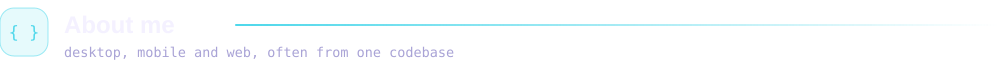
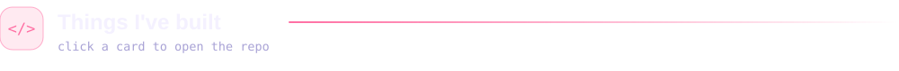
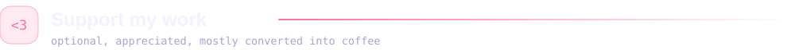
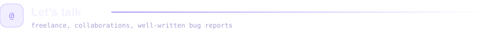

<!-- This file is generated by scripts/readme_gen.py from scripts/README.template.md. Edit the template, not this file. -->
<p align="center">
  <a href="mailto:ininou.oussematn@gmail.com"></a>
  <a href="https://github.com/Usama01TN?tab=followers"></a>
  <a href="https://ko-fi.com/usamatn"></a>
  <a href="https://ba9chich.com/fr/IninouUsama"></a>
</p>

<picture>
  <source media="(prefers-color-scheme: dark)" srcset="./assets/headers/about-dark.svg"/>
  <source media="(prefers-color-scheme: light)" srcset="./assets/headers/about-light.svg"/>
  
</picture>

**I build software that runs everywhere.** Desktop, mobile and web, often from a single codebase, with the same attention to how it feels on each screen.

- 🖥️ **Native:** Qt with C++ and Python (PyQt / PySide), shipped to Windows, macOS, Linux, Android and iOS.
- 🌐 **Web:** TypeScript, React and Node.js, from the first component to the deploy.
- 🧩 **Favourite problems:** many moving parts behind one clean interface. Fifty OCR engines behind one API, six Qt bindings behind one import, a vision model behind one hotkey.
- 🔌 **Also:** remote-desktop tooling, build and packaging tools, AI integrations, and a duck that walks across your taskbar.

```ts
const usama = {
  role:      "cross-platform software developer",
  platforms: ["Windows", "macOS", "Linux", "Android", "iOS", "Web"],
  native:    ["Qt C++", "PyQt / PySide"],
  web:       ["TypeScript", "React", "JavaScript", "HTML / CSS"],
  backend:   ["Python", "Node.js"],
  onGitHub:  { repos: 33, stars: 12, topLanguages: ["Python", "HTML", "JavaScript", "CSS"] },
  debugger:  "a rubber duck",            // 100% success rate, 0% salary
  status:    (coffee: boolean) => coffee ? "shipping" : "compiling...",
} as const;   // onGitHub is refreshed daily by a GitHub Action
```


<picture>
  <source media="(prefers-color-scheme: dark)" srcset="./assets/headers/projects-dark.svg"/>
  <source media="(prefers-color-scheme: light)" srcset="./assets/headers/projects-light.svg"/>
  
</picture>



<p align="center">
  <a href="https://github.com/Usama01TN?tab=repositories"><b>View all repositories</b></a>
</p>

<picture>
  <source media="(prefers-color-scheme: dark)" srcset="./assets/headers/toolbox-dark.svg"/>
  <source media="(prefers-color-scheme: light)" srcset="./assets/headers/toolbox-light.svg"/>
  
</picture>

<p align="center">
  
  <br/>
  
</p>

<picture>
  <source media="(prefers-color-scheme: dark)" srcset="./assets/headers/support-dark.svg"/>
  <source media="(prefers-color-scheme: light)" srcset="./assets/headers/support-light.svg"/>
  
</picture>

<p align="center">
  <a href="https://ko-fi.com/usamatn"></a>
  &nbsp;
  <a href="https://ba9chich.com/fr/IninouUsama"></a>
</p>

Everything here is free and open source. If one of these projects saved you an afternoon, a coffee is a nice way to say so. It goes toward more afternoons like that. The duck accepts tips too, but has nowhere to keep them.

<picture>
  <source media="(prefers-color-scheme: dark)" srcset="./assets/headers/contact-dark.svg"/>
  <source media="(prefers-color-scheme: light)" srcset="./assets/headers/contact-light.svg"/>
  
</picture>

Open to freelance work and to collaborating on desktop, mobile or web apps, or anything that needs to run on all three. [Email](mailto:ininou.oussematn@gmail.com) is the fastest way to reach me. The slowest is an issue titled "it doesn't work" with no further detail, which I will answer eventually and with visible restraint.


