<div align="center">

<h1>Usama Aininou</h1>

Cross-platform software developer: desktop, mobile and web.

<a href="mailto:ininou.oussematn@gmail.com"></a>&nbsp;
<a href="https://github.com/Usama01TN?tab=followers"></a>&nbsp;

</div>

<picture>
  <source media="(prefers-color-scheme: dark)" srcset="./assets/headers/about-dark.svg"/>
  <source media="(prefers-color-scheme: light)" srcset="./assets/headers/about-light.svg"/>
  
</picture>

```ts
const usama = {
  role:      "cross-platform software developer",
  platforms: ["Windows", "macOS", "Linux", "Android", "iOS", "Web"],
  native:    ["Qt C++", "PyQt / PySide"],
  web:       ["TypeScript", "React", "JavaScript", "HTML / CSS"],
  backend:   ["Python", "Node.js"],
  debugger:  "a rubber duck",            // 100% success rate, 0% salary
  status:    (coffee: boolean) => coffee ? "shipping" : "compiling...",
} as const;
```

<picture>
  <source media="(prefers-color-scheme: dark)" srcset="./assets/headers/projects-dark.svg"/>
  <source media="(prefers-color-scheme: light)" srcset="./assets/headers/projects-light.svg"/>
  
</picture>

<p align="center">
<a href="https://github.com/Usama01TN/OcrRoute"></a><a href="https://github.com/Usama01TN/QuizKey">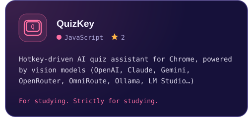</a>
<a href="https://github.com/Usama01TN/ManyQt">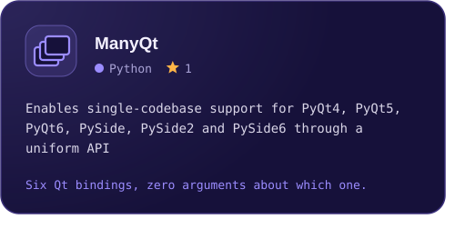</a><a href="https://github.com/Usama01TN/QFunnyWidgets"></a>
<a href="https://github.com/Usama01TN/TheWalkingDuckTaskBar"></a><a href="https://github.com/Usama01TN/PyQtBuilder">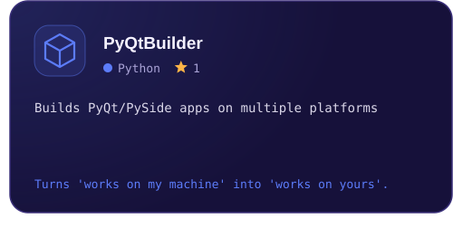</a>
<a href="https://github.com/Usama01TN/QRemoteDisplay">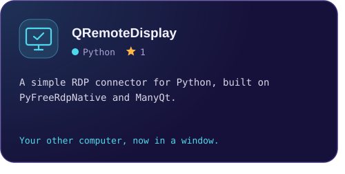</a><a href="https://github.com/Usama01TN/MiniRDPBlocker">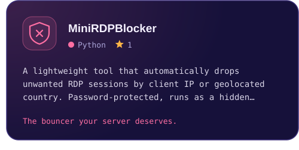</a>
</p>

<p align="right"><a href="https://github.com/Usama01TN?tab=repositories">See all repositories</a></p>

<picture>
  <source media="(prefers-color-scheme: dark)" srcset="./assets/headers/toolbox-dark.svg"/>
  <source media="(prefers-color-scheme: light)" srcset="./assets/headers/toolbox-light.svg"/>
  
</picture>

<p align="center">
  
  <br/>
  
</p>

<p align="center">
  &nbsp;
  &nbsp;
  &nbsp;
  
</p>

<picture>
  <source media="(prefers-color-scheme: dark)" srcset="./assets/headers/stats-dark.svg"/>
  <source media="(prefers-color-scheme: light)" srcset="./assets/headers/stats-light.svg"/>
  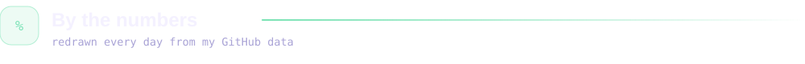
</picture>

<p align="center">
</p>

<picture>
  <source media="(prefers-color-scheme: dark)" srcset="./assets/headers/contact-dark.svg"/>
  <source media="(prefers-color-scheme: light)" srcset="./assets/headers/contact-light.svg"/>
  
</picture>

Open to freelance work and to collaborating on desktop, mobile or web apps, or anything that needs to run on all three. [Email](mailto:ininou.oussematn@gmail.com) is the fastest way to reach me. The slowest is an issue titled "it doesn't work" with no further detail, which I will answer eventually and with visible restraint.


